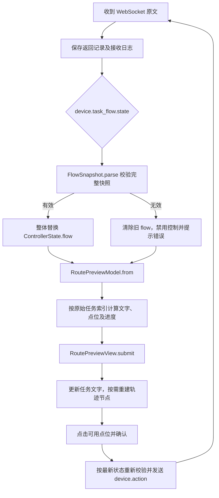

# device.task_flow.state 轨迹预览实现逻辑

本文对应 Android 控制端当前实现。说明从接收 `device.task_flow.state`、定位当前任务，到绘制轨迹和点击导航的完整处理过程。

轨迹是任务顺序和执行位置的预览，不是机器人地图或实际运动路径。数据来自状态消息的 `payload.command.tasks`，不使用任务目录、绑定点位分组或上一条流程补充空轨迹。

## 1. 代码分工与数据流

| 层次 | 实现位置 | 职责 |
| --- | --- | --- |
| 消息与会话 | [ControllerClient.kt](../src/main/java/com/lingzhi/controller/data/ControllerClient.kt) | 接收完整快照，处理订阅、离线、查询超时及动作发送前校验 |
| 协议模型 | [ControlProtocol.kt](../src/main/java/com/lingzhi/controller/protocol/ControlProtocol.kt) | `FlowSnapshot.parse`、原始任务树、索引校验及动作 JSON 构造 |
| 轨迹模型 | [RoutePreviewModel.kt](../src/main/java/com/lingzhi/controller/ui/RoutePreviewModel.kt) | 选择轨迹点、计算进度、生成任务文字及点击目标 |
| 轨迹控件 | [RoutePreviewView.kt](../src/main/java/com/lingzhi/controller/ui/RoutePreviewView.kt) | 圆点、连线、箭头、固定区域布局、溢出点位入口及文字详情 |
| 页面交互 | [MainActivity.kt](../src/main/java/com/lingzhi/controller/MainActivity.kt) | 将最新状态提交给轨迹控件，确认导航并调用动作发送 |



## 2. 状态消息及关键字段

每条状态是完整快照，任务树、索引、设备信息和按钮一起替换，不把不同消息的字段拼成一份状态。

| 字段 | 轨迹中的用途 |
| --- | --- |
| `payload.command` | 当前任务流程；为 `null` 时没有轨迹任务树 |
| `command.name` | 轨迹标题；为空时显示“无任务流程” |
| `command.tasks` | 保留原顺序的根任务数组，也是主任务索引的唯一参照 |
| `tasks[].inner_tasks` | 对应主任务的直接子任务数组，用于显示当前子任务 |
| `taskState.taskIndex` | 当前主任务在原始 `tasks` 中的索引，从 `0` 开始 |
| `taskState.status` | 主任务状态，独立显示 |
| `taskState.innerTaskIndex` | 当前直接子任务在该主任务 `inner_tasks` 中的索引，从 `0` 开始 |
| `taskState.innerTaskStatus` | 子任务状态，独立显示 |
| `buttons.pauseTask` | 当前实现判断是否允许流程内跳导航的依据 |
| `deviceInfo.robotConnected` | 空闲保留树兼容场景下，直达绑定点位的条件之一 |

一条可用于演示的状态消息：

```json
{
  "type": "device.task_flow.state",
  "id": "screen-state-101",
  "payload": {
    "deviceCode": "Device-A",
    "deviceInfo": {
      "deviceName": "展厅数字人",
      "robotConnected": true,
      "robotIp": "192.168.1.100",
      "robotBatteryPercent": 80,
      "robotCharging": false,
      "robotNormal": true,
      "robotErrorMessage": ""
    },
    "command": {
      "commandType": "task",
      "name": "展厅导览",
      "command": "exhibition-tour",
      "tasks": [
        {
          "type": "navigation",
          "step_id": 501,
          "is_show": true,
          "content": { "pointName": "序厅", "command": "lobby" },
          "inner_tasks": [
            { "type": "text", "content": { "text": "欢迎来到序厅" } },
            { "type": "video", "content": { "name": "企业介绍视频" } }
          ]
        },
        { "type": "text", "content": { "text": "展厅简介" } },
        {
          "type": "navigation",
          "step_id": 502,
          "is_show": false,
          "content": { "pointName": "内部通道", "command": "internal" }
        },
        {
          "type": "navigation",
          "step_id": 503,
          "is_show": true,
          "content": { "pointName": "创新中心", "command": "innovation" }
        },
        {
          "type": "navigation",
          "step_id": 504,
          "is_show": true,
          "content": { "pointName": "服务台", "command": "service" }
        }
      ]
    },
    "taskState": {
      "taskIndex": 3,
      "status": "IN_PROGRESS",
      "innerTaskIndex": -1,
      "innerTaskStatus": null
    },
    "buttons": {
      "pauseTask": true,
      "resumeTask": false,
      "endTask": true,
      "skipCurrentTask": true,
      "startDialogue": false,
      "endDialogue": false,
      "interruptDialogue": false,
      "stopNavigation": true,
      "shutdownRobot": true,
      "endRecording": false
    }
  }
}
```

这条消息定位到原始数组中的第 4 个主任务“创新中心”，轨迹只显示“序厅 → 创新中心 → 服务台”。“创新中心”的轨迹圆点序号是 `2`，主任务显示序号是 `4`，跳转参数则是 `stepId=503`，三者含义不同。

### 2.1 接收与校验

`FlowSnapshot.parse` 的主要检查如下：

1. `payload` 中需要有 `deviceInfo` 对象、`command` 字段、`taskState` 对象和 `buttons` 对象。
2. `taskState` 必须包含四个平级字段：`taskIndex/status/innerTaskIndex/innerTaskStatus`。
3. 两个索引接受整数或 `null`，`-1` 和 `null` 统一转为“没有当前任务”。数字字符串、小数、小于 `-1` 或超出 `Int` 范围的值被拒绝。
4. 有主任务时，索引必须落在原始根数组范围内，主状态不能为 `IDLE`；有子任务时，子索引必须落在当前主任务的直接子数组范围内，并有字符串类型的子状态。
5. 没有主任务时，主状态必须为 `IDLE`，也不能有当前子任务；没有子任务索引时，子状态必须为 `null`。
6. 主任务、子任务数组中的元素必须是对象。不能通过删除异常元素来继续解析，否则后续索引会错位。

主状态必须是字符串，子状态必须是字符串或 `null`；未知状态字符串直接显示原文。未知附加字段保留在原始对象中，不参与定位。

当前连接中的有效状态按接收顺序应用，不使用旧版 `taskId`、`innerTask.taskId`、`runtimeId/version`、`currentStepId` 或 `currentTaskIndex` 推断位置、去重或排序。状态消息的 `id` 可以由设备生成，不要求等于 `getState` 或订阅请求的 ID。接收时也不校验 `deviceCode`，路由由服务端负责；所有出站请求仍携带绑定设备码。

## 3. 当前主任务与子任务文字

当前任务直接从原始数组定位：

```text
主任务 = command.tasks[taskIndex]
子任务 = command.tasks[taskIndex].inner_tasks[innerTaskIndex]
```

界面任务序号为索引加 `1`：

```text
主任务 4 · 正在执行 · 导航：创新中心
子任务 2 · 正在执行 · 视频：企业介绍视频
```

上面两行分别演示主任务和子任务的文字格式，不表示它们属于第 2 节同一份快照。对于示例树，要显示“企业介绍视频”，状态应为：

```json
{
  "taskIndex": 0,
  "status": "TASK_COMPLETED",
  "innerTaskIndex": 1,
  "innerTaskStatus": "IN_PROGRESS"
}
```

此时主任务显示“动作完成，等待后续”，子任务仍显示“正在执行”，序厅圆点仍是当前点。主任务自身动作完成不会自动把子任务标为完成，也不会自行推进索引。

| 任务类型 | 显示名称来源 |
| --- | --- |
| `navigation` | `content.pointName`，未提供时显示“未关联导航点位” |
| `text` | `content.text`，未提供时显示“空讲解” |
| `image/video/command` | `content.name`，未提供时显示“未关联资源” |
| 其他类型 | 显示“未知步骤：类型名” |

主状态、子状态分别通过 `statusLabel` 转为中文，例如 `IDLE → 空闲`、`PAUSED → 已暂停`、`TASK_COMPLETED → 动作完成，等待后续`。没有当前主任务时显示“当前任务：无”。有子任务时第三行显示子任务详情，否则显示主／子状态摘要；尚无快照时显示“等待设备状态”或“正在获取设备状态…”。

点击轨迹标题、当前任务或状态文字，可打开完整文字详情，避免固定区域中的单行省略影响阅读。子任务只显示文字，不展开为轨迹圆点。

## 4. 从任务树生成轨迹点

`RoutePreviewModel.from` 遍历原始 `command.tasks`，保留每个节点的原始根索引 `index`。进入轨迹的条件是：

```text
node.type == "navigation"
并且 node.is_show != false
并且 node.step_id > 0
```

当前模型在 `is_show` 未提供时按可见处理。遍历保持数组顺序，不按 `order`、`step_id` 或点位名称重新排序。隐藏导航、非导航根任务和子任务不生成圆点，但仍留在原始数组中供索引定位。

每个点位模型包含：

| 属性 | 值或用途 |
| --- | --- |
| `key` | `step:节点step_id`，用于标识该轨迹节点 |
| `name` | 节点的导航展示名称 |
| `progress` | 待执行、当前任务或已完成 |
| `destination` | 可发送的导航目标；为 `null` 时点位不可点击 |

轨迹不直接从 `command_list` 绘制，因为进度必须对应完整根任务数组。一个导航节点只要满足显示条件，即使 `content` 缺少关联点位，也会保留一个不可点击的占位圆点；不能为了可点击而伪造点位数据。

## 5. 进度计算规则

进度只比较“节点原始根索引”和“当前主任务索引”，每次快照都重新计算：

```text
currentIndex = flow.taskIndex，若无当前任务则为 -1

对每个可显示的根导航节点，使用其原始 index：
    currentIndex < 0       → PENDING（待执行）
    index < currentIndex  → COMPLETED（已完成）
    index == currentIndex → ACTIVE（当前任务）
    index > currentIndex  → PENDING（待执行）
```

显示对应关系：

| 进度 | 圆点 | 圆点文字 |
| --- | --- | --- |
| `COMPLETED` | 绿色 | `✓` |
| `ACTIVE` | 蓝色 | 在完整可见轨迹点数组中的序号，从 `1` 开始 |
| `PENDING` | 灰色 | 在完整可见轨迹点数组中的序号，从 `1` 开始 |

这里的“已完成”是根据当前任务位置推导出的展示状态，不是服务端逐点完成记录；被跳过或因跳转越过的前序点也会显示绿色。实现不累计历史完成集合，向后跳转后会按新索引恢复后续点为待执行。

使用第 2 节的任务树，结果如下：

| `taskIndex` | 当前主任务 | 序厅 | 创新中心 | 服务台 |
| --- | --- | --- | --- | --- |
| `0` | 序厅 | 当前 | 待执行 | 待执行 |
| `1` | 展厅简介（讲解） | 已完成 | 待执行 | 待执行 |
| `2` | 内部通道（隐藏导航） | 已完成 | 待执行 | 待执行 |
| `3` | 创新中心 | 已完成 | 当前 | 待执行 |
| `4` | 服务台 | 已完成 | 已完成 | 当前 |

当前主任务是非导航任务或隐藏导航时，轨迹可以没有蓝色圆点；当前任务文字仍准确显示该任务。暂停只改变文字和点击能力，当前点仍保持蓝色。主任务状态即使是 `TASK_COMPLETED`，只要索引尚未推进，对应导航仍为当前点。子任务索引和状态不改变根导航进度。

## 6. 点位点击与导航动作

点位颜色和可点击性独立计算，绿色的前序点在流程运行时也可以成为跳转目标。

### 6.1 控制端可控制的前提

`ControllerState.canControl` 需要同时满足：服务器 WebSocket 已连接、绑定设备码非空、`screenOnline=true`、存在有效完整快照。订阅成功本身不等于设备在线，也不作为动作必须等待的回执。

### 6.2 导航目标选择

先检查根节点的 `content.command` 与 `content.pointName` 均非空，然后选择目标：

| 场景 | 行为 |
| --- | --- |
| 可控制，且 `buttons.pauseTask=true` | 生成 `jumpToNavigationStep`，目标为当前根节点的 `step_id` |
| 没有当前主任务，但快照仍保留任务树 | 尝试匹配绑定点位，满足条件后生成 `navigateToPoint` |
| 有当前主任务，但不允许暂停，例如已暂停 | 不生成导航目标；需先恢复任务 |
| 离线、无有效快照、关联字段缺失等情况 | 不生成导航目标，圆点禁用 |

流程内跳导航使用 `buttons.pauseTask` 判断可用性，不只检查 `status=IN_PROGRESS`，也不读取不存在的 `buttons.jumpToNavigationStep`。

直达导航的兼容分支按 `content.command` 匹配点位分组中第一个同命令点位，并要求：点位数据已加载、机器人已连接、点位启用、点位可显示或为充电桩，且点位命令和名称非空。动作的 `point/pointName` 使用绑定点位的实际值。

**当前 v1.23 设备在流程结束、取消或清空后返回 `command:null`，正常空闲状态没有可点击的轨迹点。保留树直达导航属于控制端兼容分支；正常空闲直达导航通过独立的“点位”列表提供。空轨迹不会自动拿绑定点位补齐。**

### 6.3 确认和发送

点击轨迹圆点或全部点位列表项后，`MainActivity.navigate` 显示确认对话框。确认时调用 `ControllerClient.action`，在发送线程上再次使用最新状态检查：

- 设备当前仍可控制。
- 跳任务目标仍属于当前流程的可见根导航，且 `pauseTask` 仍为 `true`。
- 直达目标仍属于已加载分组，匹配实际命令和名称，点位仍启用、可显示或为充电桩，机器人仍已连接。

因此，打开对话框后发生暂停、离线或任务树变化，不会继续按照旧界面无条件发送。

跳转到示例中的“创新中心”时，发送：

```json
{
  "type": "device.action",
  "id": "controller-jump-001",
  "payload": {
    "deviceCode": "Device-A",
    "action": "jumpToNavigationStep",
    "stepId": 503,
    "text": null,
    "point": null,
    "pointName": null
  }
}
```

兼容的直达导航动作则为：

```json
{
  "type": "device.action",
  "id": "controller-navigation-001",
  "payload": {
    "deviceCode": "Device-A",
    "action": "navigateToPoint",
    "stepId": null,
    "text": null,
    "point": "innovation",
    "pointName": "创新中心"
  }
}
```

未使用的参数显式传 `null`。发送成功只表示进入发送队列，不会立即修改本地索引或颜色；服务端无动作成功回执，等待下一份设备状态确认执行位置。断线不自动重发这些控制动作。

## 7. 固定区域绘制与长轨迹处理

轨迹控件固定显示标题、当前主任务、子任务或状态摘要；余下区域绘制圆点、名称、连线和箭头。轨迹区域不滚动，没有上一页／下一页按钮。

`Track` 尺寸变化后计算容量，宽高均指轨迹绘图区：

```text
vertical = height > width
columns = vertical ? 1 : max(1, floor(width / 70dp))
capacity = columns * max(1, floor(height / 44dp))
```

横向空间足够时按网格布局，多行采用蛇形顺序；较高较窄时采用单列。相邻实际点位之间绘制连线和方向箭头，前一个点已完成时连线为绿色，否则为浅灰色。

点数 `N` 超过容量 `C` 时，最后一个位置留给“全部 N 点”，实际预览 `max(C-1, 0)` 个点。窗口优先围绕当前点；没有当前点时围绕第一个待执行点；全部完成时围绕最后一个点。

```text
count = max(C - 1, 0)
focus = 当前点下标，否则第一个待执行点下标，否则最后一个点下标
start = clamp(focus - floor(count / 2), 0, N - count)
visiblePoints = points[start : start + count]
```

这里 `focus/start` 是过滤后的可见轨迹数组下标，只用于选择显示窗口，不能用于查询 `command.tasks` 或发送跳转。容量为 `1` 时只显示“全部 N 点”。

“全部 N 点”打开允许滚动的完整点位列表，列出打开时的全部轨迹点及进度，沿用相同的点击目标和发送前校验。该入口不绘制与前一个点的导航连线。

## 8. 刷新、空状态与离线

| 收到的事件或数据 | 处理结果 |
| --- | --- |
| 新的有效完整状态 | 整体替换 `flow`，更新文字、轨迹和按钮；结束正在等待的状态查询 |
| 仅子任务名称或状态变化 | 刷新对应文字，轨迹点没有变化时不重建点位控件 |
| `command:null` 的空闲快照 | 显示“无任务流程”“当前任务：无”和“空”；其他控制仍按快照按钮决定 |
| 有任务树但没有满足条件的根导航 | 仍显示流程名和当前任务文字，轨迹绘图区显示“空” |
| 被识别为状态消息，但快照字段、索引或任务数组无效 | 清除旧实时 `flow`，禁用控制并提示解析错误，保留原始回包；可查询恢复 |
| 当前订阅的 `screen_offline` | 立即显示离线，清除 `flow` 和轨迹，禁用控制；保留订阅和获取状态能力 |
| 状态查询 15 秒超时 | 清除旧 `flow`，提示重试；没有明确离线通知时设备状态为未知，不直接断言离线 |
| WebSocket 断开、重连中或解除绑定 | 清除实时快照；连接恢复后重新订阅并查询 |

正常状态查询发起时可以继续显示当前已有的有效快照；收到新状态、查询超时或收到离线通知后，再按对应规则替换或清除。实时更新不等待 `getState`，设备主动上报和订阅补发的完整状态走同一条处理路径。

`RoutePreviewView.submit` 先比较整个展示模型：完全相同则直接返回；模型不同则更新标题及状态文字。只有 `points` 改变时才重建点位控件，尺寸变化也会重新布局。`points` 比较包含名称、进度和导航目标，因此暂停导致点击能力改变时也会更新节点。模型中的 `identity` 是标题与点位键组成的展示标识，不是任务执行 ID，也不承担当前步骤定位。

接收原文在解析前记录到 Android `Log.d`，并进入最近 50 条“返回”记录。异常消息、未知字段和原始任务树可以在返回详情中查看，便于核对索引和实际 JSON。

## 9. 已有验证入口

| 测试 | 相关覆盖 |
| --- | --- |
| [RoutePreviewModelTest.kt](../src/test/java/com/lingzhi/controller/RoutePreviewModelTest.kt) | 原始索引进度、前序完成、非导航当前任务、向后跳转、暂停禁用、空轨迹、缺失关联及保留树兼容分支 |
| [IndexTaskDisplayTest.kt](../src/test/java/com/lingzhi/controller/IndexTaskDisplayTest.kt) | 主／子任务名称及独立状态、隐藏点不改变索引、`-1/null` |
| [IndexRouteViewTest.kt](../src/test/java/com/lingzhi/controller/IndexRouteViewTest.kt) | 子任务文字更新、完整详情、长轨迹无当前导航时的窗口跟随 |
| [IndexedStateRecoveryTest.kt](../src/test/java/com/lingzhi/controller/IndexedStateRecoveryTest.kt) | 无效索引清除旧控制，`getState` 恢复 |
| [ControllerClientTest.kt](../src/test/java/com/lingzhi/controller/ControllerClientTest.kt) | 订阅、离线、超时、重连、旧请求隔离及动作发送校验 |
| [MainActivityTest.kt](../src/test/java/com/lingzhi/controller/MainActivityTest.kt) | 轨迹点击的真实出站帧、离线禁用、固定模块与全部点位入口 |
| [ControllerPreviewRenderTest.kt](../src/test/java/com/lingzhi/controller/ControllerPreviewRenderTest.kt) | 手机、小屏手机和平板的原生布局预览 |

本文只记录当前实现逻辑，不修改消息协议或应用行为。协议、轨迹模型或点击条件变更后，应同步更新相应章节和示例。
